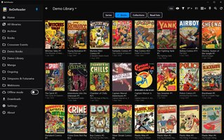
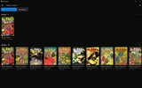
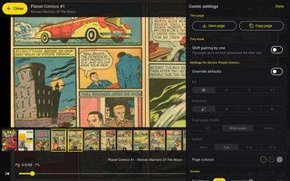
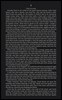
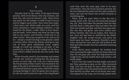
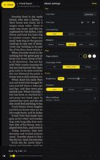
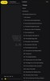
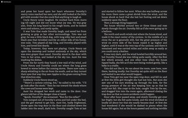
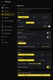

# BeDeReader

**Comics, manga and books - wherever they live.**

A reader for comics, BD, manga, webtoons and eBooks, on an Android tablet or phone, a Windows PC, and iPhone / iPad
(in testing). Your books can be on a [Komga](https://komga.org) server, in a folder on the device, or in a shared
folder on your network - one at a time, or all of them side by side. Browse with proper posters, read with touch,
keyboard, mouse or a remote page-turner, take books with you offline, and make old scans look their best.

## Where your books come from

- **A Komga server** - your libraries, series, collections and read lists, with reading progress kept on the server
  and the same on every device. Komga sorts, searches and keeps the metadata; BeDeReader shows it and keeps it in
  sync. Each of the server's libraries can be switched off on a device, in Settings > Libraries.
- **A folder on this device** - on Android its storage or a card, on Windows any drive, on iPhone and iPad the app's
  own folder in the Files app.
- **A shared folder on your network** - a NAS or a PC's share (SMB). The app asks for a user name and password only
  if the share won't let a guest in; on Windows, Windows reaches the share with its own login.
- **Several at once** - Home, search, On deck and the libraries list put every source's books together. Settings >
  Library & Home > Show where books come from puts a small icon on posters: this device, the network or Komga.
- **No Komga at all** - the sign-in screen's *Use without a server* runs the app on folders alone. A Komga server can
  be added later, in Settings > Server & Sync.

### Folders and shares as libraries

- Each library says what's in its folder, chosen when it's added: **one folder per series** (a book loose in it, or
  in _oneshots, is a book of its own), **the books of one series** (every subfolder, folder by folder), or **a read
  list** - books of several series in the order of their names ("001 - ...").
- **CBZ, CBR (RAR4 and RAR5) and EPUB**, read in place - a book isn't copied to be read, even from a share.
- Titles, numbers and dates come from the books' ComicInfo.xml (and an EPUB's own title and author), else from the
  file names: the issue number, the year, and the title without the start every book of the series shares.
- Libraries are scanned at each start and after any change, in the background; a scan reads only the files that
  changed. A library whose folder seems to have been deleted is asked about - remove it, or keep it in case it comes
  back.
- Book details say where a book is: its source, its path in the library, its format, and whether it's downloaded,
  cached or gone from its folder.
- Reading progress, pins and per-series settings for these books are this device's own - another device can't see
  the folders, so they aren't synced. Komga-only things (collections, editing read lists, deleting books) aren't
  offered on them.

## What it does

**Browsing**
- **Home**: Continue reading, On deck, pinned views, your libraries, and optional rows for recently read, recently
  added and recent releases - each can be shown, hidden and rearranged.
- **Libraries, series, books, collections and read lists** as poster grids that load as you scroll, with sorting,
  filters (Show all / Hide read / Hide unread, and Komga's own: status, genre, publisher...), item counts and
  pull-to-refresh.
- **Search** across series, books, read lists and collections.
- **Pins**: save any view (a library, a series, a read list with read books hidden...) to Home under your own name.
- **Details** for books and series: summary, credits, publisher, genres and more.
- Mark books, whole series or read lists as read or unread; select several books at once; hide books or series from
  On deck.

**Reading**
- Fit to screen, width or height; pinch, double-tap or Ctrl+wheel to zoom; a zoomed-in page is read across and down
  before turning.
- Tap the sides, swipe, use the arrow keys, the mouse wheel, a remote, or (on Android) the volume keys once you add
  them in Settings > Remote and keys. Page turn animation: none, a slide, or a 3D page curl that follows your finger.
- Two pages side by side (Dual page mode, comics and eBooks), a wide page across both; a book's pairing can be
  shifted by one.
- A page slider with a preview of the page you're picking (the previews can be switched off for a slow server).
- Right-to-left books (manga) follow Komga's reading direction, or your own setting per series.
- **Image settings per series**: Crop edges, brightness, contrast, **Enhance** (cleans up speckle and grain, then
  sharpens - on the graphics chip, once per page) and **Enhance colours** (whitens yellowed paper, deepens faded ink).
- Night mode (warm tint), a reading brightness that can go darker than the screen's minimum (the rest of the app
  keeps the screen's own brightness, so it never opens too dark to use), black, grey or white page colours, and the
  screen kept on while reading if you want it (for a few minutes after each page, or always).
- A page counter, clock, battery and progress bar over the page, and rotation, set once for every kind of book; each
  kind has its own position text.
- At the end of a book: the next one in the series or read list, with its poster - Next book or Close.
- Comics and EPUBs open in the same reader, with the same controls; a read list that mixes them goes from one to the
  other without leaving it.
- Read further (or finished) on another device while the book was open here? The reader asks before saving: stay
  where you are, or go to that page - it never saves over the other device's place without asking.

**eBooks (EPUB)**
- Novels and other EPUBs are laid out by the app itself, page by page: justified and hyphenated (English and French),
  with the book's pictures, drop caps, tables, bordered passages and footnotes (tap a footnote mark: the note opens
  over the page).
- Your choice of font (Literata, Lora, EB Garamond, Atkinson Hyperlegible Next, or the device's own), text size, line
  spacing, paragraph spacing, margins and black, dark, sepia or light page colours - as defaults in Settings > eBooks,
  and for one book in the reader (**Aa** > Override defaults: that book's own settings, on that device; Make default
  passes them on to every book). *Alignment* (the book's, justified or left), *Paragraphs* (the book's indents and
  gaps, or Auto) and *Auto-hyphenation* are set apart. A book set smaller or larger all through shows at your text size; small
  black-and-white pictures (chapter numbers, drop caps) take the page's colours.
- Contents, a slider and "page X of Y" over the whole book. A Komga book's place is kept on Komga in the same form its
  own web reader uses - pick up in either. A book is laid out and its pages counted before it shows: a few seconds
  the first time, at once after that (the count is kept on the device, per book and per text setting).
- Pictures at their own resolution; tap a large one to see it full screen. Define looks a word up in an English
  dictionary kept on the device.

**Webtoons**
- A series Komga marks as Webtoon (or any series set to the Direction *Vertical scroll*) reads as one continuous
  strip scrolled down: at its own size, as wide as the screen, or one page as tall as the screen. A gutter between
  pictures can mark the page breaks.
- Scroll with a finger, the wheel or held keys; a tap or a press glides a short way (Smooth) or most of a screen
  (Page), with tap zones at the sides or at the top and bottom.
- **Auto-scroll** at a speed you set: any touch stops it, and the controls come up with a big play button where you
  touched, to carry on. Keys can be given to start, stop and speed it up or down.
- Pinch, double-tap or Ctrl+wheel to zoom; the comics' image settings (Enhance, Enhance colours, Crop edges) apply
  to the strip.
- Opens again exactly where you stopped on this device. Episodes show the series' cover with an "Ep. N" badge.
- Webtoons have their own Settings page and their own reading defaults, apart from comics.

**Offline**
- Download single books, or a series or read list's unread (or all) books - from Komga or a shared folder - with a
  downloads limit; optionally deleted once read, and optionally only on Wi-Fi (Android). A download cut off part way
  carries on where it stopped. A book on a folder of the device itself needs no download: it's there.
- Books you open are kept on the device for a while too (up to the cache limit, 512 MB at first, the oldest opened
  going first), so they read offline without a download. Settings > Storage & Downloads sets both limits - either can
  be Off - and Clear cache empties the cache.
- **Offline mode** shows just the books with a copy on the device - by hand, or offered when Komga can't be reached.
  Nothing is read from Komga or a share while it's on; folders on the device are read as always. Started in offline
  mode, the app doesn't contact Komga at all.
- Reading done offline is sent to Komga when it's back; if you also read elsewhere, the further position wins.
  Downloads of books or series deleted on Komga are marked as such, and stay readable until you remove them.

**On the PC**
- Right-click menus, keyboard shortcuts (Esc goes back a screen), remembered window size and position, full screen
  (F11) that stays on across books.

## Screenshots

Click a picture for the full size. The comics are public-domain books from the 1940s and 50s (Planet Comics and
others), the eBooks public-domain classics from [Standard Ebooks](https://standardebooks.org).

**Libraries** - comics and eBooks, and on the PC with the side menu pinned, and search

**Comics** - a page with its controls, two pages side by side, the page curl, Enhance and Enhance colours, and on the PC

**eBooks** - a page, two pages with and without Inset page, the settings, Contents, and on the PC

**Settings** - every setting in one place, with a page per kind of book

## Getting started

1. Install the app:
   - **Android**: install BeDeReader-{version}-android.apk (allow installs from this source when asked).
   - **Windows**: unzip BeDeReader-{version}-windows.zip anywhere and run BeDeReader.exe.
   - **iPhone / iPad**: in testing through TestFlight, not on the App Store yet. Allow BeDeReader on the local network
     when iOS asks (Settings > Privacy & Security > Local Network), or it can't reach a server or a share at home.
2. On the sign-in screen, either:
   - **sign in to Komga**: its address (for example http://192.168.1.10:25600), then your email and password - the
     app makes itself an API key and keeps only that - or an API key made in Komga (your account > API keys); or
   - **Use without a server**, and pick a first folder.
3. Add more libraries in **Settings > Libraries**: *Add a folder* for one on the device, *Add a shared folder* for
   one on the network (servers you've used are listed; *Connect to a server* finds another by its name).
   - On **Android**, reading folders on the device needs All files access; the app asks, and opens the setting.
   - On **iPhone and iPad**, the app's folder is in the Files app (On My iPhone / On My iPad > BeDeReader). Copy books
     into it there, or from a Windows PC with the Apple Devices app (the device > Files > BeDeReader).

## Where your settings live

- **On Komga, for every device**: reading progress of Komga's books, per-series reader settings (fit, reading
  direction, page colours, gutter) and image settings and their defaults - comics and webtoons each their own - the
  EPUB settings (spacing, margins, formatting, page colours...), the lines under posters, Home's sections and their
  order, pins and what's hidden from On deck. Settings > Server & Sync says when this device last synced, and Sync
  now syncs it at once.
- **On this device**: the server address and API key, the local and network libraries and the shares' logins, the
  reading progress, pins and series settings of their books, each eBook's own settings, reading brightness and
  night mode, how the reader
  behaves (page turn animation, taps, keys, what's shown over the page, keeping the screen on, webtoon scrolling and
  auto-scroll speed), the eBook font and text size, poster size, remembered filters and sort orders, downloads and the
  offline mode switch. In No server mode, everything is on this device. Settings > About can reset this device's
  settings at once; each Settings page also has its own reset.

Settings (side menu) has everything in one place: All Book Types, Comics, Webtoons, eBooks and Remote and keys for reading;
Server & Sync, Library & Home, Libraries, Storage & Downloads and Look for the app; About. Groups marked "synced" are the same
on every device.

## Privacy

- The app talks to **your own Komga server and shared folders**, and nothing else - except, on Android and Windows,
  GitHub at most once a day, to see whether a newer BeDeReader has been released (it asks for the latest release and
  sends nothing about you; GitHub sees your IP address, as with any web request). No analytics, no tracking, no
  accounts, no ads.
- Settings > About has a **remote log**, off unless you set it up: it sends the app's own log to a collector at an
  address you give, with a key you give. Nothing is sent anywhere else.
- Your API key, and the user names and passwords of shared folders, are stored **on the device, encrypted**: with a
  key held in the Android Keystore on Android, in the Keychain on iPhone and iPad, and with Windows' own data
  protection (only your Windows account can read it) on a PC. If Komga won't let the app make an API key (a demo or
  restricted account), the email and password are kept the same way instead. The server address is stored
  unencrypted. Anyone with that API key can use your Komga account: you can revoke it any time in Komga (your
  account > API keys).
- On Windows the app keeps no share logins: Windows reaches the share with the login it already has.
- On Android the app allows plain http:// connections, so it can reach a Komga server on your home network that has
  no HTTPS. Like shared folders, that's for a network you trust.

## Remote page-turners

Bluetooth remotes that send arrow keys and Enter work throughout the app: arrows move between items, OK opens, and
holding OK opens an item's menu (like a long press). In the reader, OK shows the controls, Left/Right turn pages
(or, zoomed in, move across the page first), and Back closes the controls, then the book; on the page slider, OK
starts scrubbing, Left/Right pick the page and OK goes there. If your remote sends other keys, Settings > Remote and
keys chooses which keys turn pages, zoom, show the controls and close the book - one key always stays on Show the
controls, so the remote can't be locked out.

## Credits and licence

Made by **Nick Perusse** 🍁.

BeDeReader is free software under the **MIT licence** (see LICENSE): use it, change it and share it, keeping the
copyright notice.

It's an independent app, not part of the Komga project. [Komga](https://komga.org) is free, open-source software
(MIT) by Gauthier Roebroeck (gotson) and contributors. The app is built with [Flutter](https://flutter.dev); its page
enhancement adapts AMD FidelityFX Super Resolution 1 (MIT); shared folders go through
[libsmb2](https://github.com/sahlberg/libsmb2) (LGPL-2.1) by way of [dart_smb2](https://github.com/ales-drnz/dart_smb2),
and CBRs through [koni_rar](https://github.com/zenbaku/koni_archive) (MIT). Everything the project relies on -
libraries, fonts, build tools - is listed, with the notices they require, in THIRD_PARTY_NOTICES.md (in the app:
About > Third-party software). What's new in each build is in CHANGELOG.md (About > What's new).

**AI usage:** this application was developed with the aid of AI coding tools, but was designed, reviewed, and
tested by a human.

## Feedback

Bug reports and ideas are welcome as [GitHub issues](https://github.com/akajimmy/bedereader/issues). The project
doesn't take pull requests.

## For developers

The rest of this file is about building the app.

### The repository

- **komga_reader\** - the Flutter app: Dart in lib\, shaders in shaders\, tests in test\, native code in android\,
  ios\ and windows\. The reader is one screen (lib\screens\reader.dart: controls, keys, progress, moving between
  books) with a renderer per kind of book (lib\reader\: comic pages - and a webtoon's strip - and EPUB).
- **Where books come from**: lib\book_source.dart is what every source answers (Komga's API as the screens use it);
  lib\api.dart is Komga, lib\offline\ its downloads, lib\local\ the folders and shares (their files, the scan, the
  catalogue), and lib\combined_source.dart puts them side by side for the screens.
- **komga_reader\third_party\koni_rar\** - the RAR reader, vendored with BeDeReader's additions (its pubspec.yaml says
  which).
- **CHANGELOG.md** - what each build contains. **README.md** - this file. **THIRD_PARTY_NOTICES.md** - everything the
  project relies on, and the notices it must carry. All three are bundled into the app by the build.
- **LICENSE** - MIT.
- **tools\build.ps1** - the build pipeline; **tools\release.ps1** - tags a release candidate or a release;
  **tools\install-android.ps1** - installs on an Android device over wireless ADB; **tools\update-desktop.cmd** -
  puts the newest Windows build in Desktop\BeDeReader; **tools\ios-status.ps1** - how a build's iPhone / iPad
  (TestFlight) build on GitHub is going; **tools\testing\** - scripts for checking builds on real devices (its README
  says which).
- **tools\make_icon.py** - draws every app icon from one set of shapes. **tools\exp_identity.py** and
  **tools\exp-identity\** - the BeDeReader Exp identity a build puts on and takes off (Building, below).
- **keytest\** - a page for finding out which keys a remote sends.
- **dev_setup.py** - downloads and verifies the toolchain.

### Toolchain

The app builds on Windows (Android and Windows; iOS builds on GitHub, below). You need:

| What | Notes |
|---|---|
| Flutter 3.47 (stable) | the version the app is built and tested with |
| JDK 17 | for the Android build (Temurin is fine) |
| Android SDK (command-line tools) | platform tools, a build-tools and platform matching the app's targetSdk |
| Visual Studio Build Tools 2022 | the C++ workload with the "C++ ATL" component (the encrypted key storage's Windows part needs ATL) |
| Windows Developer Mode | on (Flutter's Windows plugins need symlinks) |
| Python 3 | for dev_setup.py and the icon and docs tools |

**dev_setup.py** downloads Flutter, the JDK and the Android command-line tools, checks each against its published
SHA-256 and unpacks them under C:\Dev (C:\Dev\flutter, C:\Dev\jdk17, C:\Dev\android-sdk) - no installers, no PATH
changes. tools\build.ps1 expects them there: with a toolchain somewhere else, change the two lines near its top that
set JAVA_HOME and put Flutter on PATH.

The first build of a network-shares version fetches libsmb2 from dart_smb2's GitHub release (its build step checks
the files' SHA-256), so it needs internet once.

For an interactive shell, set the same two things (JAVA_HOME to the JDK, Flutter's bin folder on PATH) and work from
komga_reader\. The everyday commands there:

1. **flutter analyze** - static checks (lint findings fail the build)
2. **flutter test** - the test suite (**flutter test -x slow** for a quicker run while working)
3. **flutter run -d windows** - run on the PC with hot reload

Checks over real EPUBs live in tool\epub_checks\, outside the test suite, and do nothing unless pointed at books (run
one with **flutter test tool\epub_checks\{file}**): epub_library_check_test.dart (every book opens and lays out;
BEDEREADER_EPUB_DIR) and epub_sample_pages_check_test.dart (sample pages of each book as pictures, laid out as on a
tablet; BEDEREADER_EPUB_LIST and BEDEREADER_EPUB_OUT, or one book with BEDEREADER_EPUB_FILE and optionally
BEDEREADER_EPUB_CHAPTER).

### Building

From the repository's folder: **powershell -ExecutionPolicy Bypass -File tools\build.ps1 -Bump**

(Windows blocks .ps1 scripts by default; -ExecutionPolicy Bypass lifts that for this one run without changing any
setting. The same goes for the other scripts in tools\.)

**Which app it builds.** Every build is **BeDeReader Exp** unless -Stable is given. BeDeReader Exp is a separate app
that installs beside BeDeReader, never over it: Android ID com.nickp.komga_reader.exp, iOS bundle ID
com.nickp.bedereader.exp, Windows data in %LOCALAPPDATA%\KomgaReaderExp and %APPDATA%\com.nickp\Komga Reader Exp, a
striped "under construction" icon, and no update check. It's where everything new is tried. **-Stable** builds
BeDeReader itself, for release candidates and releases. tools\exp_identity.py puts the Exp identity (IDs, names, icons
from tools\exp-identity\) on the working tree just before the platforms are built and takes it off straight after, so
it's never committed; the Dart side follows --dart-define=BEDEREADER_EXP=true. Both apps share one line of build
numbers: an Exp build is tagged exp-build-{n}, a stable one build-{n}, and {n} is always past the highest of either.

Checks the working tree is committed (before and after flutter pub get), runs analyze - lint findings included - and
the tests (stopping on any failure), raises the build number, files the changelog's *Unreleased* entries under the new
build, bundles the README, changelog and third-party notices into the app, builds Android and Windows into
dist\{version}\ with checksums and a BUILD-INFO.txt, then commits and tags exp-build-{n} (or build-{n}). If a build
fails, the version, changelog and bundled documents are put back. A -Bump build must be signed with the release key,
and its tag must not exist yet. The Windows build starts from an empty build folder, so the zip holds only that
build's files.

A -Bump build then pushes its tag to GitHub, where .github\workflows\testflight.yml builds that same commit as the
same app for iPhone and iPad on a Mac runner and uploads it to TestFlight with the same version and build number - about 15-20
minutes, while the device and the Desktop copy are updated. **tools\ios-status.ps1 -Build {n}** says how it's going;
-NoIos keeps the tag local and skips it. (The workflow signs and uploads with the repository owner's App Store Connect
key, kept in the repository's secrets.)

Options: -Platforms android (or windows) builds one of them; -Timing compiles in the EPUB reader's timing instruments
(a measuring build); -SkipTests skips the tests; -NoInstall skips the device and the Desktop copy; -AllowDirty allows
uncommitted changes. The last two are for throwaway builds: -Bump refuses both. Progress is in dist\build.log.

After a Windows build the app is unpacked fresh and swapped in as BeDeReader-Exp (a -Stable build: BeDeReader) on your
Desktop, the copy you use day to day; the copy it replaces is kept beside it as .previous (rename it back if a build misbehaves). Your
settings and downloads aren't in those folders, so nothing is lost. If the app is open from there, that step is
skipped and says so: close it and run tools\update-desktop.cmd (or double-click it).

After an Android build the APK is installed on a paired Android device over wireless ADB (with several, set
ANDROID_SERIAL to the one to use). Pairing is a one-time step: **adb pair IP:PORT** (adb is in the Android SDK's
platform-tools) with the code from the device's Settings > Developer options > Wireless debugging > Pair device with
pairing code. Wireless debugging must be on for installs (Android switches it off whenever the device leaves the
Wi-Fi); if the device can't be reached the build still succeeds and says so - install later with
tools\install-android.ps1. After installing, it checks the device reports the new build and holds exactly this APK
(SHA-256).

**Release signing (Android):** komga_reader\android\key.properties (copy key.properties.example; never committed)
names the keystore, which lives outside the repository. Its password is kept encrypted with your Windows account in
%USERPROFILE%\.keystores\android-release.pass - make it once, in PowerShell:

1. **$p = Read-Host 'Keystore password' -AsSecureString**
2. **$p | ConvertFrom-SecureString | Set-Content "$env:USERPROFILE\.keystores\android-release.pass"**

The build decrypts it for the Android build only, then checks which key actually signed the APK (in the log and
BUILD-INFO.txt). Without the keystore or password it falls back to the debug key and says so. Android only updates an
app signed with the same key, so the release key must never change: back up the keystore and keep its password in a
password manager (the encrypted copy only works for this Windows account on this PC).

Outputs in dist\{version}\:
- BeDeReader-{version}-android.apk - install on an Android device (sideload)
- BeDeReader-{version}-windows.zip - portable: unzip anywhere, run BeDeReader.exe

### Renaming the app

The app was called "Komga Reader" until 2026-09-29, when it became BeDeReader - which is why some internal names
below still say Komga Reader. A rename is a display-only change; everyone keeps their settings, downloads and updates,
because the internal identifiers never change. Keep the name plain ASCII (BeDeReader, not BéDéReader): the same
spelling is displayed, typed, searched and used in file names.

- **Change** (the name people see): komga_reader\lib\app_identity.dart (appName - every screen);
  android\app\src\main\AndroidManifest.xml (android:label); ios\Runner\Info.plist (CFBundleDisplayName and
  CFBundleName); windows\runner\main.cpp (window title); windows\runner\Runner.rc (FileDescription, InternalName,
  OriginalFilename); windows\CMakeLists.txt (BINARY_NAME, the .exe); tools\build.ps1 ($product, $appLabel and
  $fileName); tools\exp_identity.py (its text edits match the current names); this README, the changelog's intro, THIRD_PARTY_NOTICES.md, lib\licences.dart (the AI disclosure).
- **Never change** (internal): the Android application ID and Kotlin package com.nickp.komga_reader; the iOS bundle ID
  com.nickp.bedereader; the Dart package komga_reader; Runner.rc's CompanyName and ProductName (they name the Windows
  settings folder %APPDATA%\com.nickp\Komga Reader); the Windows data folder %LOCALAPPDATA%\KomgaReader
  (desktop_channel.cpp); the Komga client-setting keys komgareader.*.

### Working on changes

- Development happens on a version branch (now 1.6, the local and network libraries version); each new version gets
  its own branch, and the previous one ends at its last release. One branch per change, off the version branch:
  **git switch -c change/two-page-mode 1.6**, commit there, keep flutter analyze and flutter test green, then merge
  back into 1.6.
- Versions: every build after a release is a build of the next version (after 1.1, builds show 1.2.0). When a build
  is good enough to be a release candidate, **tools\release.ps1 -Rc 1** tags it v1.2.0-rc.1; when one is the release,
  **tools\release.ps1 -Final** tags it v1.2.0 and moves the version on to 1.3.0 for the next build. Both note it in the
  changelog and commit; neither pushes. Only a build whose BUILD-INFO.txt shows passed tests, a clean tree and the
  release key, and whose files still match SHA256SUMS.txt, can be tagged. (The 1.1 release was numbered 0.1.1, tag
  v0.1.1.)
- GitHub runs flutter analyze and the tests on every push and pull request (.github\workflows\checks.yml). Analyze
  fails on lint findings too, including a Future left un-awaited (unawaited_futures): await it, or wrap it in
  unawaited(...) when it's meant to run on its own.
- While working on a change, flutter test -x slow runs everything but the tests tagged slow (dart_test.yaml); the
  build runs them all. Time the app's logic depends on (throttles, gaps, retries) is read through package:clock, so a
  widget test moves it on with its own clock instead of waiting.
- New behaviour gets a test in test\, and a fix gets a test that fails without it. Shared test code is in
  test\support\:
  - fakes of Komga extend TestKomga and are built through noNetwork(...), so any call a fake doesn't answer fails the
    test instead of reaching the network;
  - ready-made fakes for the reader, libraries and downloads, Home, and the synced client settings;
  - memory_fs.dart and the RAR and zip writers: a library's files in memory, and CBZs and CBRs made on the spot;
  - epub_reader.dart opens an eBook held in memory in the reader, lets it settle and reads where it is - shared by
    the eBook reader's test files;
  - app_shell.dart runs the whole app (KomgaReaderApp) against a recorded fake server;
  - helpers.dart holds setView, a waitUntil that fails loudly, test images, and the shader preload.

  Shaders are run for real in tests (test\enhance_test.dart).
- Add a line to CHANGELOG.md under *Unreleased*; the build moves it under the new build number.
